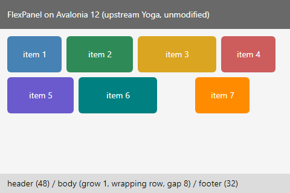

# Spike D (reduced): FlexPanel on Avalonia 12 over upstream's Yoga

Run 2026-11-22 at upstream `28a87225` with Avalonia 12.1.6, first on .NET SDK 10.0.402 and then on 11.0.100 (the tests are the same either way). Project: `spikes/D-flex/`. Run it with `dotnet test spikes/D-flex/Reactor.Avalonia.Flex.Tests`.

## Scope: what ran, and what was set aside

HANDOVER asked for a vertical slice with four parts: `UseState` plus a button, a controlled `TextBox`, a keyed list through upstream's `ChildReconciler`/`KeyedListDiff`, and `FlexPanel` over the unmodified Yoga. **Only the FlexPanel part ran.**

The other three need upstream's `RenderContext` and `ChildReconciler` to run on our Avalonia layer, which means implementing the seam Spike A measured: 226 members on 55 types, including `Reconciler.Mount`, the `Element` base and `ElementModifiers`. That doesn't fit in one session.

The choice was made in away mode and is logged in FINDINGS.md under "Decisions taken while you were away". `spikes/A-engine/seam.json` is the spec for that next step.

## What was built

| Piece | Lines | Source |
|---|---|---|
| Yoga engine (`src/Reactor/Yoga/*` except FlexPanel.cs) | 5,046 | **linked verbatim**, 10 files |
| `FlexPanel` for Avalonia | 415 (upstream WinUI file: 978, about 60% of it comments) | hand port of `Yoga/FlexPanel.cs` |
| Upstream Yoga tests (`tests/Reactor.Tests/Yoga*.cs`, `YogaGenerated/*.cs`) | about 35,000 | **linked verbatim**: 35 of 36 files. `YogaValueExtensionsTests.cs` (70 lines) is left out because it also imports upstream's Markdown namespace |
| FlexPanel headless tests | 14 tests | new, written against the CSS Flexbox results in the style of upstream's `FlexPanelCssBehaviorFixtures`. Those fixtures run inside a WinUI app and can't be linked |

### The port

The layout logic is kept line for line: the two-pass measure, the arrange from cached Yoga results, the `MeasureFunction` bridge with the `[ThreadStatic]` outer-mode handshake, and the CSS §4.5 automatic minimum size. Mechanical changes:

- `DependencyProperty` → `StyledProperty`/`AttachedProperty`. `PropertyMetadata` callbacks → `AffectsMeasure` plus `Changed` observers.
- `Visibility.Collapsed` → `!IsVisible`. `XamlRoot.RasterizationScale` → `TopLevel.RenderScaling`. `Unloaded` → `OnDetachedFromVisualTree`.
- No `ScrollView`, only `ScrollViewer`.

Avalonia's `Measure`/`DesiredSize`/`Arrange` include the child's `Margin` exactly as WinUI's do, so the margin arithmetic carried over unchanged. It compiled first time.

## Results

- **Upstream's Yoga tests: 780 of 780 pass** on net10.0 with no WinUI, against the unmodified Yoga sources.
- **FlexPanel tests: 14 of 14 pass** (794 tests in all). Each covers one behaviour:
  - a grow child takes the remaining width;
  - a header/body/footer column fills the window, including the panel's own `DesiredSize`;
  - wrap with gaps;
  - an invisible child takes no space and no gap;
  - changing an attached `Grow` relays out;
  - asymmetric margins;
  - `justify-content: space-between`;
  - wrapped text in a column matches `StackPanel` (upstream's "CssStack" parity idea);
  - a headless-rendered demo frame;
  - FlexPanel as an `ItemsControl`'s ItemsPanel: an attached-property change relays out;
  - an alignment change re-measures;
  - negative margins larger than the slot don't throw;
  - a nested panel picks up a child's height change;
  - re-attaching to a larger host lays the children out again (a guard).
- **Clean run:** a fresh clone of the branch at `67c25c2`, with `upstream` supplied through a junction, passed 789 of 789. After both review rounds, the worktree run passes 794 of 794, and a fresh clone of `main` after the merge passes too (see FINDINGS.md).
- **Tests proven to fail: 11 of 11 behaviours** (8 at first, plus 3 added after review). Two more tests are guards against findings that did not reproduce. One of them, for an alignment change, stays green even without the registration it was written for, because Avalonia already re-measures; the registration was dropped. Each was broken on committed code and the right test went red; the code was then restored. Two tests stayed green on the first try and were strengthened:
  - The margin test used symmetric margins, and centring hid a wrong arrange rect.
  - The column test missed a wrong `DesiredSize`, because Arrange re-solves the layout.

## Where the abstraction leaked

- **An explicit size beats flex-grow at Arrange**, in Avalonia exactly as in WinUI. "item 7" in the demo has `Grow = 1` and a `Width`: Yoga gives it the grown slot, but the control stays at its `Width`, centred in the slot. CSS would grow the box. Upstream has the same behaviour, so it is parity, not a port bug. It cost one wrong test.
- **A child's own size changes don't reach the panel by themselves in Avalonia.** Upstream relies on WinUI re-measuring the parent when a child's Width, Height, Margin or Visibility changes. Avalonia re-measures the child at its old exact slot, so its `DesiredSize` doesn't change and a nested panel keeps a stale size. The port registers those properties with `AffectsParentMeasure`. This was found by review pass 2 and reproduced by a test.
- **Layout runs on the render tick in Avalonia 12.** Headless tests have to pump the dispatcher (`Dispatcher.UIThread.RunJobs()`). WinUI has no equivalent step.
- **Test framework versions differ:** Avalonia.Headless.XUnit 12.1.6 is built on xunit v3 3.2.x, while upstream uses 4.0.3. The linked upstream tests compiled and ran unchanged on 3.2.2.
- **`Bitmap.Save(string)` is obsolete** in Avalonia 12.1 and the replacement options type is abstract; kept with a pragma.

## What it says about sync

- **Yoga is the best case:** 5,046 source lines and about 35,000 test lines taken verbatim, with zero edits.
- **FlexPanel is a rewrite we must watch.** In Spike B's 13-week window upstream's `FlexPanel.cs` had no commits, but each future change to it needs a manual port.
- **Upstream's tests are reusable where they test platform-neutral code.** For layout and Yoga that held completely; the WinUI-hosted FlexPanel fixtures don't link.
## Review

- **Pass 1** (`high`, about 79k tokens): 8 found, 5 fixed, 3 waived.
  - **Fixed:**
    - Attached-property invalidation now finds the panel by its visual parent, as upstream does, so FlexPanel works as an ItemsPanel.
    - Negative-margin rects are clamped.
    - The `FlexMinWidth`/`FlexMinHeight` accessors are renamed for XAML.
    - The tests close their windows.
    - The line count is corrected.
  - **Waived:**
    - *Alignment changes don't re-measure:* checked, and Avalonia 12 already re-measures; the test guards it.
    - *The ambient Yoga mode leaks into the min-content probe,* and *Avalonia's measure cache ignores the ambient mode:* both are inherited from upstream, and keeping parity keeps the port easy to diff. Both are candidates for an upstream fix.
- **Pass 2** (`medium`, about 71k tokens): 6 found, 4 fixed, 2 changed course after checking.
  - *A nested panel keeps a wrong size* (important): reproduced by a test, but the cause differed from the one predicted. The reviewer expected a wrong fill height; the test showed a stale height after a child's size changed. Fixed with `AffectsParentMeasure`, and the test goes red without it.
  - *Children arranged at 0×0 after re-attach* (important): did not reproduce; the guard test passes with no change.
  - **Fixed:** `LangVersion 15` and the polyfill in both projects; the report's placeholder; the line count; the remaining negative-margin clamps.
