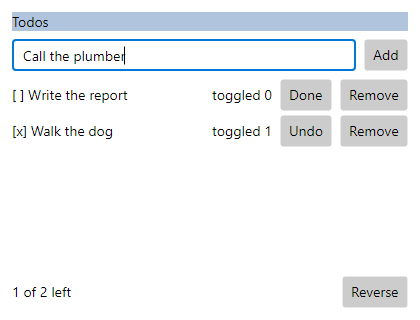

# Spike G: the vertical slice (hooks, controlled TextBox, keyed list, FlexPanel) on Avalonia 12

Issue #2: the engine half of Spike D. Upstream baseline `14172dce` (UPSTREAM.lock), Avalonia 12.1.6, .NET 11 SDK 11.0.100,
targets `net10.0`. Measured 2026-11-23 by an agent (Opus). Every number says how it was measured. Judgements are marked [J].

## Answer

- **The premise runs on Avalonia 12.** Function components with upstream's hooks drive real Avalonia controls through
  upstream's `ChildReconciler` and `KeyedListDiff`: a counter and a todo app work end to end with headless mouse and
  keyboard input, and render to PNG (below).
- **Upstream's own engine tests run against the library:** 605 tests from 39 upstream files. 548 of them (34 files) are
  linked unchanged; 57 (5 files) come through rules that drop 8 tests of tier 3 pieces. All pass.
- **The headline hooks are pinned to upstream's semantics** by 15 new tests through the reconciler, on top of the 14
  from #1 and upstream's own.
- **The controlled TextBox keeps upstream's rule,** and two tests pin it. Upstream's rule is more precise than FINDINGS
  states it (see "Where the abstraction leaked", 3).
- **FlexPanel is in the library** (tier 3, over the vendored Yoga), with a `FlexElement` that mirrors upstream's.
- **The tests:** 712 in `tests/Isotope.UI.Avalonia.Tests` (62 before this issue), in about 3 s.

## Upstream's engine tests

How they were chosen: every file under upstream's `tests/Reactor.Tests` that names an engine type (`RenderContext`,
`ChildReconciler`, `KeyedListDiff`, `ChangeEchoSuppressor`, `ContextScope`, `ReactorListState`) and has no WinUI,
WinRT or Roslyn-analyzer reference, plus `ChildReconcilerTests` and `CallbacksMemoTests`: 68 files. Each was compiled
against the library (namespace rename only), dropping files with errors until the build was clean, then run.

| Outcome | Files | Tests run |
|---|---|---|
| Tier 1: compile and pass unchanged | 34 (+ `TestIsolationCollections.cs`, the collection definitions) | 548 |
| Tier 2: one rule each set (8 member drops, 1 find/replace) | 5 | 57 |
| Left out: need tier 3 types | 29 | 0 |

- **The tier 2 drops** (`tools/sync/transforms.json`, `drop-test-*`):
  - theme hooks (`UseColorScheme`, `UseIsDarkTheme`): 2;
  - `UseMemoCells`/`UseMemoCellsByKey`, vendored but not compiled (they need the theme layer): 3;
  - `TextBlockElement.FontSize` and `ThemeBindings`, which our hand-written records don't have yet: 2;
  - the ambient-animation curve map (animations are tier 3: every kind maps to no curve): 1. This is the only test that
    compiled and failed.
  - `ChildReconcilerTests` also gets `Microsoft.UI.Xaml.Controls.Orientation` → `global::Avalonia.Layout.Orientation`.
- **The 29 left out** need, by first build error: upstream's element factories (`Factories`, `ElementFactory<>`: 5
  files), hosting and windows (6), `UseMemoCells` (2), validation types (2), diagnostics, devtools, docking, animation
  scopes, ETW capture or tooling (9), or `Callbacks<>`, `IReactorKeyed`, `FakeTimeProvider`, menu data or a sample's
  camera type (5). They come in as those layers do.
- **How it runs:** `tools/sync` vendors them under `src/Upstream/tests/Reactor.Tests` (40 files, 18,447 lines with
  `wc -l`), and the library's test project links them, Yoga's excepted (`tools/sync/verify` runs those).
- **Counted by** `dotnet test tests/Isotope.UI.Avalonia.Tests --filter FullyQualifiedName~Isotope.UI.Tests.` (605) and the
  same filter on the 5 tier 2 classes (57).

## What works, and the tests that pin it

The library's own tests, counted per class with `dotnet test --list-tests` and the run totals: 107 (62 before).

| Area | New tests | What they pin |
|---|---|---|
| Headline hooks (`HeadlineHooksTests`) | 15 | `UseState`: the setter is the same delegate every render; two calls from one closure both write the rendered value + 1; state per instance. `UseReducer` (functional form): updates queued before a render compose, one render; an equal result asks for no render. `UseReducer` (reducer form): `Dispatch` is stable and runs the current render's reducer; an equal state asks for no render. `UseEffect`: runs after the render function; an empty dependency list runs once and cleans up on unmount; every pending cleanup runs before any new effect, in hook order; a parent's effect runs before its child mounts and its cleanup runs first; an effect's state change renders again. `UseCallback` identity until a dependency changes. `UseMemo` with no dependencies computes once. `UseRef` per instance. `UseContext` from a provider inside a stateful component. |
| Controlled TextBox (`ControlTests`) | 2 | A rejected edit stays while the TextBox element is skipped, until the value changes; an element updated for another member writes a drifted value back. Neither write echoes. |
| Keyed list (`KeyedListTests`) | 5 | Rows that are components with their own state, effect and uncontrolled TextBox: reorder, reverse, insert, remove, and all three at once keep each surviving row's controls (`Assert.Same`), state and typed text, and unmount only removed rows. |
| FlexPanel (`FlexPanelTests`) | 14 | Spike D's tests, moved with the port. |
| FlexElement (`FlexElementTests`) | 7 | Container members written; `.Flex(...)` data written and reset on a reused control; keyed reorder in a flex row keeps controls and lays out in the new order; a container change updates the same panel; an equal `FlexElement` is skipped; upstream's argument checks. |
| Examples (`ExampleTests`) | 2 | The counter and the todo app, end to end. |

### The examples

`tests/Isotope.UI.Avalonia.Tests/Examples.cs`: the README's counter, and a todo app that uses `UseState` (a controlled
TextBox), `UseReducer` (the list), `UseMemo` (the count left), `UseContext` (an accent), keyed rows that are components
with their own state, and Flex layout. `ExampleTests` mounts them in a headless window (Skia rendering, Fluent theme),
clicks and types with Avalonia.Headless's input methods, and schedules each root pass on the dispatcher as an app host
would (`DispatcherHost`). The counter renders once per click (4 renders for 3 clicks, asserted).




The PNGs are the tests' captures, copied from the test output folder.

## Measured numbers

**Keyed list timings.** `dotnet run -c Release --project spikes/G-slice/Measure` mounts 1,000 keyed rows headless (no
window, no rendering). Each row is a memoized function component with `UseState`, a TextBlock and a Button. Each case
runs 7 times after a warm-up, on a fresh tree, on the development machine. "Kept" counts the rows whose control is the
same object after the change.

| Case | Median | Rows kept |
|---|---|---|
| mount | 37.98 ms | |
| re-render, same keys | 1.52 ms | 1000 of 1000 |
| reverse | 42.13 ms | 1000 of 1000 |
| move last to first | 0.51 ms | 1000 of 1000 |
| insert 1 in the middle | 0.47 ms | 1000 of 1000 |
| remove every other | 16.23 ms | 500 of 500 |
| shuffle (seeded) | 23.40 ms | 1000 of 1000 |
| one row's state change (a root pass) | 0.44 ms | |

**Code.**

- The library now compiles 92 vendored files, 26,385 lines (82 files and 21,339 lines before): Yoga's 10 files are new.
  `node tools/measure-transforms.mjs src/Isotope.UI.Avalonia/UpstreamFiles.props`.
- `tools/sync` vendors 235 files (165 tier 1, 70 tier 2); `transforms.json` has 125 rules (116 before): the 9 test rules.
- New tier 3 code: `Layout/FlexPanel.cs` 415 lines (Spike D's port, namespace changed), `Seam/FlexElement.cs` 121
  lines (the record, `FlexAttached`, `.Flex(...)`). The seam gained one `ShallowEquals` arm and a fix in
  `Seam/Threading.cs`.

## Where the abstraction leaked

1. **Avalonia 12 binds `Dispatcher.UIThread` to the first thread that reads it.** The seam's
   `DispatcherQueue.GetForCurrentThread()` read it to answer "is this the UI thread?", so on a thread with no dispatcher
   it made that thread the UI thread. Upstream's `UseResource` captures "the current dispatcher" that way and then posted
   its continuation to a queue nothing pumped. A vendored upstream test found it (a 10 s timeout). The seam now asks
   `Dispatcher.FromThread(Thread.CurrentThread)` first. WinUI's `DispatcherQueue.GetForCurrentThread()` returns null on
   such a thread and has no side effect.
2. **Process-wide engine state and parallel tests.** Upstream's unit tests expect no captured `ReactorApp.UIDispatcher`;
   our threading tests set one. They now run in a collection with parallelization disabled.
3. **The controlled-value rule is the element's, not the value's.** FINDINGS (decision 3 after Spike F) says "a value
   equal to the last render's isn't re-applied". In upstream's engine:
   - an equal TextBox element is skipped (`ShallowEquals`), so a rejected edit stays;
   - but when the element is updated for any other member, the controlled entry compares the box's text with the value
     ("write only on real drift", Spec 047 §8) and writes it back.

   So a rejected edit stays only until the TextBox element changes, not until the value changes. Both halves are pinned,
   as upstream's behaviour. The wording is under "Proposed for shared files" in the report to the coordinator.
4. **Effects run before the children mount,** as upstream's reconciler does: a component's effects flush when its render
   returns, so a parent's effect runs before its child exists, and unmount cleans up the parent first. This is upstream's
   semantics, not React's (React runs child effects first). Pinned, not changed.
5. **A keyed move detaches the control.** Upstream's `PanelChildCollection.Move` is `RemoveAt` then `Insert`. On Avalonia
   that takes the control (and its subtree) out of the logical tree and puts it back, and in a window out of the visual
   tree too. Reversing 1,000 rows costs 42 ms against 0.5 ms for a single move. Avalonia's `Controls` collection has a
   `Move`; whether it avoids the detach, and what it saves, isn't measured [J: worth a measurement before #14].
6. **The element vocabulary is thin.** Upstream tests that use `TextBlockElement.FontSize`, `ThemeBindings` or upstream's
   element factories can't link yet; that's 2 dropped tests and 5 left-out files.
7. **FlexPanel's minimum-size attached properties are `FlexMinWidth`/`FlexMinHeight`** (Spike D: Avalonia's
   `Layoutable` already has `MinWidth`/`MinHeight`). `FlexAttached` and `.Flex(minWidth:)` keep upstream's names; only
   the panel's static setters differ, in `ApplyFlexChildAttached`.
8. **There is no app host yet.** Upstream's `ReactorHost`/`ReactorHostControl` are tier 3. The examples use a 40-line
   test host that posts root passes on the dispatcher.

## Not done

- **No real window.** Everything is headless (a real-window run is ask-first).
- **No app host in the library** (8 above).
- **The 29 upstream test files** that need tier 3 types.
- **Keyed moves through Avalonia's `Move`** (5 above).

## Reproduce

```sh
dotnet test tests/Isotope.UI.Avalonia.Tests                 # 712 (needs no upstream/)
dotnet run -c Release --project spikes/G-slice/Measure      # the timings ([-- <rows> <runs>], default 1000 7)
node tools/sync/sync.mjs --check --no-fetch                 # the vendored tests match upstream + rules
node tools/measure-transforms.mjs src/Isotope.UI.Avalonia/UpstreamFiles.props
```
